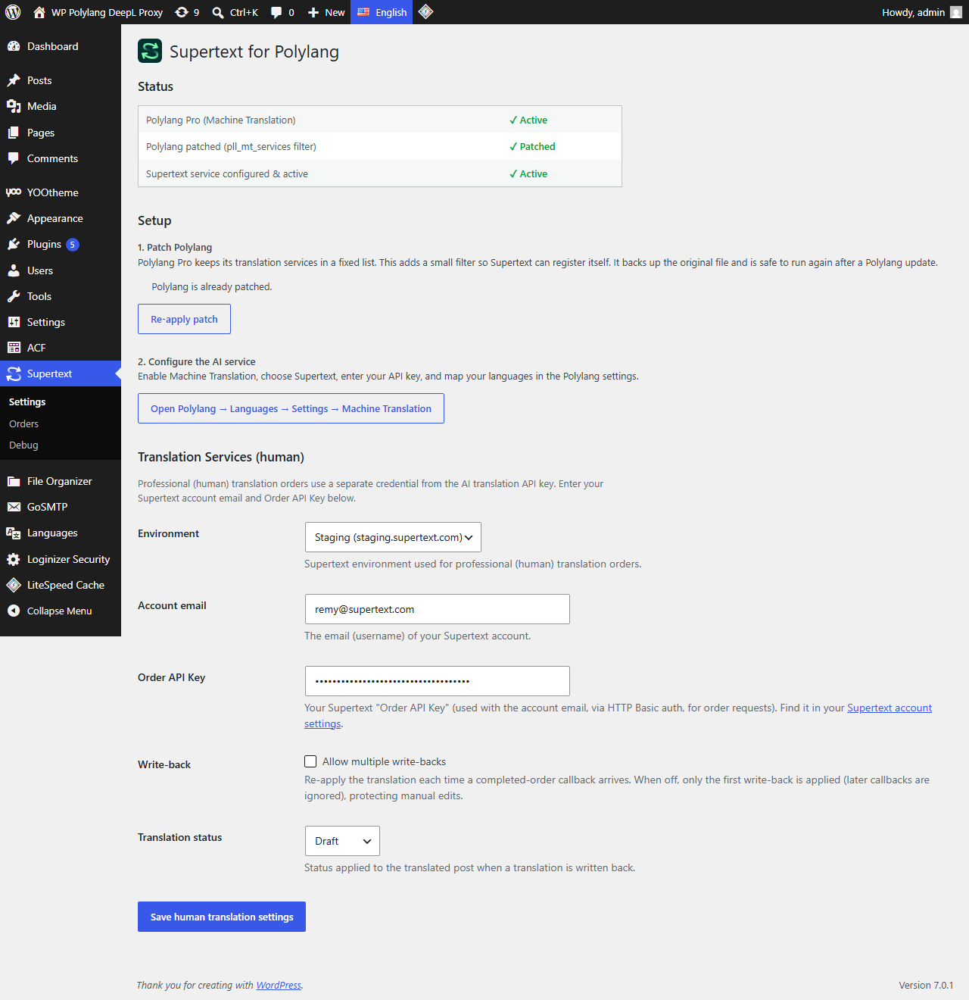
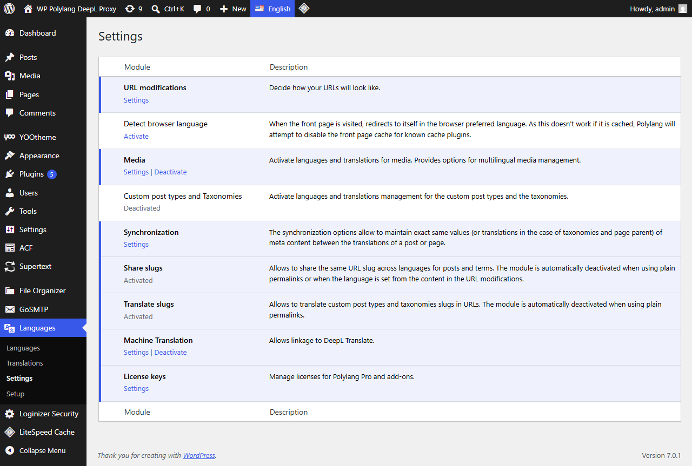
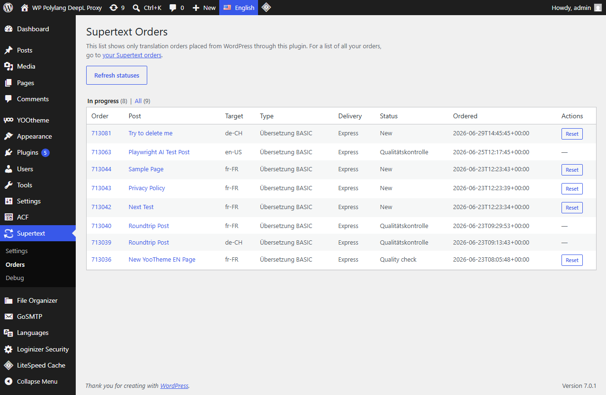

# Supertext for Polylang — User Guide

Adds **Supertext** as a native **machine‑translation** *and* **human (professional)
translation** service in **Polylang Pro**.

- **AI translation** — translate posts/pages instantly through Supertext's AI, using
  Polylang's own translate buttons and a bulk action.
- **Human translation** — order professional translations from WordPress; the finished
  translation is written back automatically when it's done.
- **Page screenshots for translators** — each page sent for human translation is captured
  through its secret preview link and attached to the order, giving the translator the page
  in its real layout (via [VibeBoost Screenshots](https://vibeboost.me) — optional, on by default).
- **Translation files** — export a post as an XLIFF 1.2 or HTML file for a translation tool,
  a translator or Supertext's web app, and import the translated file again
  (*Export for translation* / *Import translation*).
- **Secret preview links** — share an unpublished draft (or hand it to an external tool)
  through a private, expiring URL, without publishing it. Toggle the whole feature on/off in
  Supertext → Settings; enable and manage each page's link from the editor sidebar.

---

## Table of contents

- [Requirements](#requirements)
- [Installation](#installation)
- [Patching Polylang (one‑time)](#patching-polylang-one-time)
- [Configuration](#configuration)
  - [AI / Machine Translation](#ai--machine-translation)
  - [Human (professional) translation](#human-professional-translation)
  - [Language mapping](#language-mapping)
  - [Translation review](#translation-review)
  - [Version information and the API key check](#version-information-and-the-api-key-check)
  - [Checking the status](#checking-the-status)
- [Usage](#usage)
  - [Translate a single post (AI)](#translate-a-single-post-ai)
  - [Bulk AI translation](#bulk-ai-translation)
  - [Bulk human translation](#bulk-human-translation)
  - [The Orders page](#the-orders-page)
  - [YOOtheme pages](#yootheme-pages)
  - [Gravity Forms](#gravity-forms)
  - [Page screenshots (VibeBoost)](#page-screenshots-vibeboost-screenshots)
  - [Translation files (XLIFF or HTML)](#translation-files-xliff-or-html)
  - [When a translation can't start](#when-a-translation-cant-start)
- [Compatibility](#compatibility)
- [How it works](#how-it-works)
- [FAQ](#faq)
- [Troubleshooting](#troubleshooting)
- [Developer reference (filters)](#developer-reference-filters)

---

## Requirements

- **WordPress** 6.0+ and **PHP** 8.1+
- **Polylang Pro** with the **Machine Translation** module
- A **Supertext** account — [create one (or log in)](https://www.supertext.com/person/en/account/signin)
  - an **AI translation API key** (for AI), and/or
  - an **account email + Order API Key** (for human translation orders)
- The server must reach `https://api.supertext.com` over HTTPS (and, for
  [Translation review](#translation-review), Supertext's review service
  `https://localizationreview-production.up.railway.app`)

---

## Installation

1. Copy the `supertext-polylang` plugin folder into `wp-content/plugins/` (or upload the
   ZIP via **Plugins → Add New → Upload Plugin**).
2. Activate **Supertext for Polylang** in **Plugins**.
3. A **Settings** link appears in the plugin's row, and a **Supertext** menu appears in the
   admin sidebar.

---

## Patching Polylang (one‑time)

Polylang Pro keeps its translation services in a fixed internal list with no extension
hook, so Supertext can't register itself until a tiny one‑line filter is added to
Polylang. The plugin does this for you:

1. Go to **Supertext → Settings**.
2. Under **Setup → 1. Patch Polylang**, click **Patch Polylang**.

It backs up the original file (`Factory.php.bak`) and is safe to run again after a Polylang
update. The **status panel** at the top of the Settings page shows whether the patch is
currently applied.



---

## Configuration

### AI / Machine Translation

AI translation is configured in Polylang's own Machine Translation settings.

1. Go to **Languages → Settings → Machine Translation** (the **Settings** page has a
   button that links straight there), enable **Machine Translation**, and choose
   **Supertext**.
2. Enter your **API key**. No Supertext account yet? [Create one at supertext.com](https://www.supertext.com/person/en/account/signin).
   You can generate the key at
   **[supertext.com → Integrations → API](https://www.supertext.com/en/integrations/api)** (requires the *Admin* role) — the field links to
   it directly.
3. Pick the **Environment** (Live / Staging / Testing).
4. Under **Language mapping**, choose the **Supertext language** for each Polylang
   language (see [Language mapping](#language-mapping) below).
5. Save. The service becomes active once a key is stored. Saving checks the key at once
   (a cost-free request to Supertext, nothing is translated or billed) and shows the result
   with the Supertext section: *API key checked: the connection to Supertext works.*, or what
   is wrong (see [API key check](#api-key-check)).

In Polylang's **Languages → Settings**, the **Machine Translation** module is where you
click **Settings** to choose Supertext and enter the key:



### Language mapping

Supertext accepts only the language codes it offers: German, English, French, Italian and
Portuguese with a region (`de-CH`, `de-DE`, `en-US`, `fr-CH`, `pt-BR`), Chinese and Serbian
with a script (`zh-Hans`, `sr-Latn`), Swiss German as `gsw-u-sd-chzh` / `gsw-u-sd-chbe`, and
all other languages without a region (`es`, `nl`, `sl`, `fi`, `ja`).

In **Languages → Settings → Machine Translation → Supertext → Language mapping**, each
Polylang language (the default language too) has a row with its name and locale and:

- **Supertext language** — a drop-down of the languages Supertext offers, shown as
  *Name (code)* with the name in your back-end language (*Deutsch (Schweiz) (de-CH)*). It
  shows the language you saved; if you haven't saved one yet, the **suggested** language is
  preselected, and that is also what is sent until you save:
  1. the Supertext language whose code equals the locale, apart from case and `_`/`-`
     (`de_CH` → `de-CH`, `en_US` → `en-US`, `es` → `es`);
  2. else the usual one (see the table below);
  3. else, for WordPress's formal and informal variants (`de_DE_formal`, `de_CH_informal`,
     `nl_NL_formal`), the same for the locale without the variant (`de_DE` → `de-DE`,
     `de_CH` → `de-CH`, `nl_NL` → `nl`).

  A language with no suggestion shows **— choose —**: `en_IE`, `gsw`, `ca_valencia`,
  `pt_PT_ao90`, for example. Until you choose its Supertext language, translations into or
  from it stop with an error and nothing is sent to Supertext.
- **Formality** — *Automatic*, *Formal* or *Informal*, only for languages where Supertext
  offers it (not for English, Swiss German, Romansh, Albanian or Serbian, for example); the
  choice appears and disappears as you change the Supertext language. For locales ending in
  `_formal` it is preselected as *Formal*, for `_informal` as *Informal*; *Automatic* lets
  Supertext decide.
- **Translation review** — a checkbox, off by default: translations into this language go
  through Supertext's review service (see [Translation review](#translation-review)).
- **Status** — the code that is sent (`✓ de-CH`; *Suggested; saved with the settings* until
  you save), or **Not mapped**. If a developer sets the code with the
  `supertext_polylang_language_code` filter, the status shows that code with *Set by the
  supertext_polylang_language_code filter*: the filter wins over the drop-down.

Click **Save** to store the choices. Only Supertext's own codes are saved.

| Polylang locale | Suggested Supertext language |
| --- | --- |
| `de_CH`, `en_GB`, `fr_CH`, `pt_BR`, … (code Supertext offers) | the same code (`de-CH`, `en-GB`, …) |
| `de`, `en`, `fr`, `it`, `pt` (no region) | `de-DE`, `en-US`, `fr-FR`, `it-IT`, `pt-PT` |
| `zh_CN`, `zh_SG` / `zh_TW`, `zh_HK`, `zh` | `zh-Hans` / `zh-Hant`, `zh-Hans` |
| `sr`, `sr_Latn_RS` | `sr-Latn` |
| A region of a language Supertext offers without one (`es_ES`, `nl_NL`, `fi_FI`, `nb_NO`) | the language (`es`, `nl`, `fi`, `nb`) |
| `de_DE_formal`, `de_CH_informal`, `nl_NL_formal` | as `de_DE`, `de_CH`, `nl_NL`, with formality preselected |
| Regions Supertext doesn't offer (`en_IE`, `en_AU`, `fr_BE`, `de_LI`), `gsw`, `sr_RS`, `ca_valencia`, `pt_PT_ao90` | none: **— choose —** |

One mapping serves both directions: when the language is the source, its code is sent
without region (`de-CH` → `de`). The status panel on **Supertext → Settings** lists the same
languages with their codes.

### Translation review

With **Translation review**, people check the translations on the website itself and
correct them there: customers or Supertext linguists open the original and the translated
page side by side in Chrome with the *Supertext Localization Review* extension and fix texts
in a side panel. Their corrections come back into WordPress.

Turn it on per language that is translated **into**: **Languages → Settings → Machine
Translation → Supertext → Language mapping** → tick **Translation review** in that
language's row → **Save**. Untick it to turn it off again; nothing else changes.

- AI translations into that language then go through Supertext's review service instead of
  directly to Supertext. It answers exactly like Supertext and passes everything on with your
  API key, so billing, languages, formality and error messages stay the same. Other languages
  keep going directly to Supertext.
- The review service keeps every translation of your account. A text it has translated
  before gets the same translation again (without a new Supertext call), and once a reviewer
  has corrected it, the corrected text.
- **Corrections arrive with the next translation:** after a review, translate the posts or
  strings again to write the corrections into WordPress. As always, translating again replaces
  manual changes in the translated texts.
- Reviewers get a review link for your site from Supertext; nothing to set up in WordPress.
- The review service works with keys of the **live** Supertext API. With the *Staging* or
  *Testing* environment, leave review off.
- Only AI translation uses it: human (professional) translation orders and the automatic API
  key check always go directly to Supertext, and *Export for translation* / *Import
  translation* don't use it.

The review service's address can be changed with the constant or environment variable
`SUPERTEXT_REVIEW_URL` (e.g. `define( 'SUPERTEXT_REVIEW_URL', '' );` in `wp-config.php`);
an empty value turns review off for every language. Only change it when Supertext gives you
another address.

### Version information and the API key check

**Supertext → Settings → Translation Services (human) → Version information → Send version information to Supertext**
(on by default):

> Sends the site URL and the versions of this plugin, WordPress and the runtime to
> Supertext when you save these settings and after an update, so Supertext support can see
> which version you run. No content, no API key and no personal data are sent.

Exactly what is sent (as JSON to the Supertext Commando Center): the event (`installed`,
`settings_saved`, `upgraded`, `api_key_check`), the site URL (`home_url()`), the plugin name
(`supertext-wordpress-polylang`) and version, the WordPress version, the PHP version, the
version of the bundled Supertext SDK, whether an API key is set, the result of the latest
API key check (`ok`, `invalid`, `missing`, `unreachable` or `error`, when it ran, Supertext's
HTTP status and error code) and the address of the plugin's ping endpoint (below). Reports
are sent when you save the Supertext or Polylang settings, when the plugin, WordPress or PHP
version changed (noticed on the Supertext pages, Polylang's settings page or a translation),
and when the key check result changes. A failed report is tried again after an hour at the
earliest and never affects a save or a translation.

**Turn it off** by unticking the setting and saving, or on the server with the environment
variable `SUPERTEXT_VERSION_REPORTS=0` (`false`, `off`, `no`; `1`/`true`/`on`/`yes` turns it
on). The environment variable wins over the setting; the settings page says so when it is
set. With version information off, nothing is sent and the ping answers 404.

**Ping endpoint:** `https://<your site>/wp-json/supertext/v1/ping` (with plain permalinks
`https://<your site>/?rest_route=/supertext/v1/ping`). Supertext calls it with
`?challenge=…` to check that the site is reachable; it needs no login and answers only
`{"ok":true,"plugin":"supertext-wordpress-polylang","challenge":"…"}`, with
`Cache-Control: no-store`. Exclude it from page caches and firewalls that block the REST API
if Supertext should see the site as reachable.

#### API key check

The API key is checked automatically when you save the settings, and again when the key
changed. The result is kept and shown in the status panel of **Supertext → Settings** (with
the time of the check) and in the Supertext section of Polylang's settings. **Test
connection** in the status panel runs the check again. The check runs whether or not version
information is on; only the report depends on the setting.

| Result | Message |
| --- | --- |
| ok | API key checked: the connection to Supertext works. |
| invalid | Supertext rejected the API key. Check that you copied the whole key, or generate a new one at supertext.com → Integrations → API (requires the Admin role). No Supertext account yet? Create one at supertext.com. |
| missing | No API key is set yet. No Supertext account yet? Create one at supertext.com. Generate your API key at supertext.com → Integrations → API (requires the Admin role). |
| unreachable | The API key couldn't be checked because Supertext can't be reached. The settings are saved; check again later. |
| error | The API key couldn't be checked: Supertext answered with an error (HTTP status). The settings are saved; check again later. |

### Human (professional) translation

Professional orders use a **separate** credential (HTTP Basic auth), configured on the
plugin's own settings page.

1. Go to **Supertext → Settings → Translation Services (human)**.
2. Choose the **Environment** (Live / Staging / Testing).
3. Enter your **Account email** and **Order API Key** — find the Order API Key in your
   **[Supertext account settings](https://www.supertext.com/services/customer/accountsettings)** (the field links to it). No Supertext account yet?
   [Create one at supertext.com](https://www.supertext.com/person/en/account/signin).
4. Choose the **Write‑back** behaviour:
   - **Allow multiple write‑backs** — re‑apply the translation on every completed‑order
     callback (off by default, so the first result wins and your manual edits are kept).
   - **Translation status** — whether the written‑back translation is a **Draft** or
     **Published**.
5. Optionally review the **Secret preview links** and **Page screenshots** switches (both on
   by default). *Page screenshots* attaches a snapshot of each ordered page to the order for
   the translator — see [Page screenshots (VibeBoost)](#page-screenshots-vibeboost-screenshots).
6. Save.

### Checking the status

The **status panel** at the top of **Supertext → Settings** shows, at a glance, whether
Polylang Pro is active, whether the patch is applied, whether the Supertext service is
configured and active, the latest **API key check** (with **Test connection**), each
Polylang language with its Supertext language (or **Not mapped**), and whether version
information is sent. (It's the same page shown above.)

---

## Usage

### Translate a single post (AI)

Open a post, and use Polylang's normal **“translate with Supertext”** button in the
languages panel / metabox to create a translation in the target language. (The Supertext
logo marks the action.)

### Bulk AI translation

1. Go to **Posts** (or **Pages**) → list view.
2. Select one or more items.
3. In the **Bulk actions** dropdown choose **Supertext AI Translation**.
4. Pick the **target language** that appears next to the dropdown.
5. Click **Apply**.

Each selected item is translated and a linked translation is created. A notice reports how
many translations were created. (Items already translated, or whose source language equals
the target, are skipped.)

**Translation review:** if your administrator turned on *Translation review* for a language,
reviewers (your colleagues or Supertext linguists) check and correct the translations on the
website. Their corrections come into WordPress the next time you translate the content into
that language: after a review, translate it again. Texts reviewed once keep their corrected
wording in later translations.

### Bulk human translation

1. Select items in the **Posts**/**Pages** list.
2. Choose **Supertext Human Translation**.
3. Pick the **target language** and the **translation type** (BASIC / PREMIUM / CREATIVE).
4. The plugin fetches a **live price quote** from Supertext and fills the **delivery**
   dropdown with the available options **and their prices** (e.g. *“Express — 90.00 CHF”*).
   Pick a delivery option.
5. Click **Apply**.

> **About the price quote:** the delivery dropdown stays disabled until a quote arrives.
> When you pick a translation type + target language (with at least one post selected), the
> plugin uploads the content to Supertext and requests a quote, then shows each delivery
> option with its price and delivery date (as a tooltip). Only the delivery options actually
> offered for that language pair are shown — these can differ from one language pair to the
> next. Selecting more posts or changing the type/language re‑fetches the quote.

The content is then sent to Supertext as an order. The confirmation notice shows the
**Order ID**, linked to the order in your Supertext account. When the order is finished,
Supertext calls back and the translation is written into the target post automatically (as
a Draft or Published, per your settings).

> **Page screenshots ([VibeBoost Screenshots](https://vibeboost.me)):** when the *Page screenshots* option is
> enabled (Supertext → Settings, on by default), the plugin also captures a screenshot of
> each page — reached through its secret preview link, so even an unpublished draft is
> included — and attaches it to the order as a **visual reference** for the translator
> (uploaded as a reference file, `DocumentTypeId 3`). This is best‑effort: if the screenshot
> can't be produced (service unreachable, subscription required, or the site isn't publicly
> reachable), the order still goes through without it. The service is still in development;
> heavier use may require a subscription.

### The Orders page

**Supertext → Orders** lists every order placed from WordPress:

- **Order ID** (links to Supertext), **Post**, **Target**, **Type**, **Delivery**,
  **Status**, **Ordered** date.
- **In progress / All** filter (hides *Collected* orders by default).
- **Refresh statuses** pulls the current status from Supertext.
- **Reset** (debug only) removes the per‑post lock so you can order that post again. It
  does **not** cancel the order at Supertext; a confirmation popup explains this.
- A link to your full **Supertext orders** overview.



### YOOtheme pages

YOOtheme Pro stores a page's layout as JSON. The plugin translates it **field‑by‑field**
(only the real text — headings, paragraphs, etc.), leaving the layout structure intact, so
YOOtheme pages translate correctly without breaking. No extra setup is required.

### Gravity Forms

Gravity Forms are **not** WordPress posts — they live in their own tables and are dropped
onto a page by ID (via the `[gravityform]` shortcode or block), so Polylang can't translate
them through its normal pipeline. This plugin adds a dedicated integration instead.

**1. Turn it on.** Go to **Supertext → Settings** and click **Detect plugins**. When Gravity
Forms is found, a **Gravity Forms** entry appears under the **Supertext** menu. (The menu is
hidden until the integration is detected and enabled.)

**2. Add the form strings to Polylang.** Open **Supertext → Gravity Forms** and click
**Add to String Translations**. This lists every form's translatable text under Polylang's
own **Languages → String translations**, so form fields are translated and stored exactly
like the rest of your site's strings. (Click **Remove from String Translations** later to
hide them again — existing translations are kept either way.)

**3. Translate a form.** Each form is listed with a column per non‑default language:
   - **Translate (AI)** — shown while a language is still untranslated. Click it to translate
     the whole form with Supertext AI.
   - **✓ Translated** / **⚠ Partly translated** — the current status. To review, edit or
     re‑translate, use **Edit translations** (or **Languages → String translations**), which
     opens that form's strings in Polylang's grid.

   What gets translated: the form title and description, each field's label, description,
   placeholder and validation message, drop‑down/radio/checkbox choices, the submit button,
   and the sub‑labels of multi‑input fields — a **Name** field's *First*/*Last* and an
   **Email** field's *Confirm* box, including any custom sub‑labels you set. Hidden
   sub‑fields (such as an unused name prefix or suffix) are skipped.

**4. It shows automatically.** On the front end, when a visitor views the form in a
non‑default language, the plugin swaps in the stored translation at render time (via
`gform_pre_render`/`gform_pre_validation`). Nothing changes in the source form; the original
language is served untouched. If a string has no translation for the current language, the
default text is shown as‑is.

> Translations live in **Polylang's** String Translations (keyed by the source text), not
> inside Gravity Forms — so re‑saving a form in Gravity Forms won't erase them. New or
> changed fields simply need a re‑translate.

> **Caching note:** front‑end pages may be cached, so after translating a form do a hard
> refresh (or purge your page cache) to see the new text.

### Page screenshots (VibeBoost Screenshots)

When you order a **human translation**, the plugin can attach a **screenshot of the page** to
the order, so the translator sees the content in its real layout — not just the extracted
text. Screenshots are produced by **[VibeBoost Screenshots](https://vibeboost.me)** (a hosted service, still in
development).

**How it works**

1. For each page in the order, the plugin generates the page's **secret preview link** (see
   [Secret preview links](#secret-preview-links)) — so even an **unpublished draft** can be
   captured.
2. It sends that link to VibeBoost, which renders the **full page** (the whole scrollable
   page, not just the visible area), **auto-dismisses cookie/consent banners**, and returns
   an image.
3. The image is uploaded to the Supertext order as a **reference file** (`DocumentTypeId 3`)
   alongside the translatable content, and appears on the order next to the `.html` file.

**Turning it on/off** — **Supertext → Settings → Page screenshots** (on by default). It
depends on **Secret preview links** being enabled (same settings page); if that master switch
is off, draft pages can't be captured.

**Best‑effort** — attaching a screenshot never blocks an order. If VibeBoost is unreachable,
your plan requires a subscription, or the site isn't publicly reachable from the internet, the
order simply goes through **without** a screenshot.

> **Requirements & caveats**
> - The site must be **reachable from the public internet** for VibeBoost to load the page —
>   screenshots won't work against a purely local/firewalled dev site.
> - Heavier use of VibeBoost Screenshots may require a **subscription**.
> - Ordering a translation **auto‑enables** the source page's secret preview link (with the
>   default expiry) so the page can be captured; you can turn it back off per page from the
>   editor.

### Translation files (XLIFF or HTML)

Instead of translating with Supertext right away, export a post as a file, have it
translated elsewhere — in a translation tool (Trados, memoQ, Phrase …), by a translator, or
by uploading it to Supertext's web app — and import the translated file again. Polylang Pro
has an XLIFF export of its own (*Languages → Translations → Export*); this one is Supertext's
format, which the other Supertext plugins share, checks each text on import and also offers
HTML.

**Export for translation**

1. In **Posts** (or **Pages**), hover the post and click **Export for translation**. The
   *Supertext → Translation files* page opens with the post.
2. Choose the **File format**:
   - **XLIFF 1.2 (for translation tools)** — the better choice for translation tools, which
     protect the formatting. Several target languages go into one file.
   - **HTML (one language per file)** — for Supertext's web app and anyone who translates
     HTML. Translators must leave the file's head and the `data-st-id` attributes alone.
3. Tick the **Target languages** (the site's other languages) and click **Download file**
   (`wordpress-<post id>-<language>.xlf`, or `wordpress-<post id>.xlf` for several languages).

The file holds exactly the texts the AI translation would send (title, content, excerpt, the
custom fields and ACF fields set to *Translate*, YOOtheme texts). A post with nothing to
translate gives *Nothing to translate.* and no file.

**Import translation**

1. Open **Supertext → Translation files**.
2. Choose the **Translated file (XLIFF or HTML)** (at most 10 MB).
3. Tick **Also import texts whose source changed since the export** only if you want those
   too (see below). Click **Import translation**.

The texts are written into the post's translation in that language, exactly as an AI
translation is written: the translation is created (linked to the original) if it doesn't
exist yet and saved as a **draft** for review; YOOtheme and ACF texts go back into their
fields. An existing translation's texts are replaced by the file's. You need to be allowed to
edit the original and its translation (or to create one).

A summary per post and language follows:

| Line | Meaning |
|------|---------|
| **Imported** | Written into the translation. |
| **Skipped, source changed since the export** | Someone edited the original after the export, so the translation may be out of date. Not written unless you tick *Also import texts whose source changed since the export*. |
| **Not translated in the file** | The translator left the text empty. |
| **Formatting changed, not imported** | The translation broke or added formatting (tags) the original doesn't have. |
| **Not in the file** | Texts added to the post after the export. Export again to translate them. |

An HTML file imported unchanged writes the original text into the translation (HTML can't
mark a text as untranslated), so only import HTML files that have been translated.

| Message | What it means |
|---------|---------------|
| *This file isn't a valid XLIFF or HTML translation file.* | The file is damaged or isn't XLIFF or HTML. |
| *This file wasn't exported by the Supertext plugin, or its header was removed.* | Use a file from *Export for translation*; in HTML files the head must stay as it was. |
| *This file belongs to another system (…).* | The file comes from another Supertext plugin (another CMS). |
| *The post this file was exported from no longer exists.* | The post was deleted after the export. |
| *The site has no language ….* | The language was removed from Polylang after the export. |
| *The file is too large (at most 10 MB).* | Export fewer languages per file. |
| *Sorry, you are not allowed to edit this post.* | You may not edit the original or its translation. |

### When a translation can't start

If a language has no Supertext language yet, AI translation into or from it stops with:

> *English (Ireland) (en_IE) has no Supertext language, so nothing was sent to Supertext.
> An administrator can choose it in the drop-down for this language under Languages →
> Settings → Machine translation → Supertext → Language mapping.*

Nothing was sent or billed. Ask your administrator to map the language, then translate
again. The message appears in German, French or Italian when your WordPress profile uses
one of these languages (the Supertext screens and messages follow your back-end language;
some older screens are still English only).

---

## Compatibility

Both AI and human translation send and receive content through **Polylang Pro's own
export / import pipeline** — the exact same pipeline Polylang uses for its XLIFF
export. The practical upshot: **if Polylang Pro can translate it, Supertext can translate
it.** There is no separate, parallel content parser to keep in sync.

### Works out of the box (via Polylang Pro)

| Content | Notes |
|---------|-------|
| **Gutenberg (block editor)** | All core blocks; block content is exported as translatable text, structure preserved. |
| **Classic editor** | Post/page body, title, and excerpt. |
| **Custom fields / post meta** | Only the meta keys you mark as **“Translate”** in *Languages → Settings → Custom fields* (Polylang Pro). Keys left as *Copy* / *Ignore* are not sent. |
| **ACF (Advanced Custom Fields)** | Text, textarea, WYSIWYG, and other text‑bearing fields, through Polylang Pro's built‑in ACF integration. Field‑group translation settings in ACF/Polylang are respected. |
| **Taxonomies & terms** | Category/tag/custom‑taxonomy names and descriptions that Polylang exports. |
| **SEO plugin meta** | Yoast SEO / Rank Math titles & descriptions translate when Polylang is set to translate their meta keys (same rule as any custom field). |

### Added by this plugin

| Content | Notes |
|---------|-------|
| **YOOtheme Pro** | Polylang does **not** handle YOOtheme's JSON layout out of the box. This plugin adds a **field‑by‑field** integration (see [YOOtheme pages](#yootheme-pages)) so its text translates without corrupting the layout. `code` elements are deliberately skipped. |
| **Gravity Forms** | Forms aren't posts, so Polylang can't translate them. This plugin adds a **per‑form AI translation** tool and injects the translation at render time (see [Gravity Forms](#gravity-forms)). Enable it from **Detect plugins** on the Settings page. |
| **Page screenshots** | Optionally attaches a **[VibeBoost](https://vibeboost.me)** screenshot of each page to its human‑translation order as a visual reference (see [Page screenshots](#page-screenshots-vibeboost-screenshots)). On by default. |

### Not translated

- **Other page builders** (Elementor, Divi, WPBakery, Beaver Builder, …) unless they ship
  their own Polylang export integration — their content isn't exposed to the pipeline, so
  it passes through untranslated. (A YOOtheme‑style integration could be added per builder.)
- **Custom fields left as *Copy* or *Ignore*** in the Polylang settings.
- **Non‑text data** — IDs, URLs, CSS, shortcodes' structural parts, and raw `code` blocks
  are intentionally left intact.

> In short: **manage *what* gets translated in Polylang's own settings** (custom fields,
> taxonomies, ACF). Supertext simply performs the translation on whatever Polylang hands it,
> plus YOOtheme.

---

## How it works

- **AI:** the plugin registers Supertext as a Polylang machine‑translation service. Content
  is gathered by Polylang, sent to Supertext's AI **file** translation endpoint, and the
  translation is written back through Polylang's normal import pipeline.
- **Human:** the content is uploaded to Supertext and an order is created. A secure,
  signed callback URL receives the “order done” notification, the translated file is
  downloaded, and the text is written back into the target post.

Both paths share the same field extraction, so page‑builder (YOOtheme) and ACF content are
handled the same way.

---

## FAQ

**A page says “this page has a human translation order in progress, so it can’t be
deleted” — but I already reset/cancelled the order (and deleted the translation). How do
I clear it?**

The delete block is driven by the plugin’s **order registry** (the
`supertext_polylang_orders` WordPress option) — *not* by the translation page or the
trash. A source page stays locked while **any** order for it is still “open”, meaning **not
completed and not `Cancelled`**. So deleting the translated page or emptying the trash does
not lift it.

To clear it:

1. Go to **Supertext → Orders**, switch the filter to **All**, and click **Reset** on
   **every** row that belongs to that page. A page can have more than one order (e.g. one
   per target language, or one left at status `Delivered`/`Unknown`), and each **Reset**
   only cancels a single order — so reset them all.
2. If a row still won’t clear, everything lives in that one option. With **WP‑CLI**:
   ```bash
   wp option get supertext_polylang_orders --format=json      # inspect
   wp option delete supertext_polylang_orders                 # wipe (history only — safe)
   ```
   `delete` only clears the Orders‑page list; it touches nothing translation‑related and
   won’t come back on its own. To remove just one order instead of all, set its `status`
   to `Cancelled` in that option. Optionally tidy leftover `_supertext_order_<lang>` meta
   on the source page. The same edits are possible via **phpMyAdmin** (`wp_options`).

The lock disappears the moment no open order references the page — no re‑save needed.

**Can I order human translation for a page that’s already translated?**

Yes — but **Reset** the previous order first (**Supertext → Orders**), otherwise you’ll get
*“An order already exists.”* A re‑order re‑translates the whole source. Whether the
delivered result overwrites the existing translation depends on the **“Allow multiple
write‑backs”** setting: **off** (default) keeps the first result and your manual edits;
**on** overwrites. Once a translation is delivered, its order lock is cleared
automatically, so you don’t need a manual Reset for the next round.

---

## Troubleshooting

- **“…has not been patched to expose the pll_mt_services filter”** — click **Patch
  Polylang** on **Supertext → Settings**. After a Polylang update, re‑apply it.
- **AI service shows inactive** — make sure Machine Translation is enabled in Polylang and
  a Supertext API key is saved. If a DeepL key is also set, DeepL (listed first) wins —
  clear it to use Supertext.
- **“… has no Supertext language, so nothing was sent to Supertext”**
  (`supertext_unsupported_language`) — the Polylang language named in the message (e.g.
  *English (Ireland) (en_IE)*) has no Supertext language in the mapping and no suggested
  one (its drop-down shows *— choose —*). An administrator chooses it in **Languages →
  Settings → Machine Translation → Supertext → Language mapping** (see
  [Language mapping](#language-mapping)); the status panel on **Supertext → Settings** lists
  the languages that aren't mapped.
- **“Supertext offers this language pair, but not with the option "politeness"”**
  (`supertext_unsupported_feature`) — formal/informal was sent for a language where Supertext
  doesn't offer it. Set the language's **Formality** to *Automatic* in the language mapping.
- **“Supertext does not support this language pair (en → …)”** — Supertext doesn't offer that
  pair, or the code chosen in the **language mapping** isn't one Supertext knows; the message
  shows the codes that were sent.
- **“Supertext rejected the API key …”** / **“Authentication failure …”** — copy the whole key
  again or generate a new one at
  [supertext.com → Integrations → API](https://www.supertext.com/en/integrations/api)
  (requires the Admin role); no account yet?
  [Create one at supertext.com](https://www.supertext.com/person/en/account/signin). Then click
  **Test connection** on **Supertext → Settings**.
- **“The API key couldn't be checked …”** — Supertext couldn't be reached (network, firewall,
  proxy) or answered with an error (the HTTP status is in the message). The settings are
  saved; click **Test connection** later.
- **“Authentication failure” only for languages with Translation review** — the review service
  only works with keys of the live Supertext API: with the *Staging* or *Testing* environment,
  untick *Translation review* in the language mapping.
- **Reviewers' corrections don't show up in WordPress** — they arrive with the next
  translation: translate the content into that language again. Check that the language's
  *Translation review* is ticked.
- **“source and target language are the same”** — you can't translate a post into its own
  language; pick a different target.
- **Human order placed but nothing comes back** — check **Supertext → Debug** for the most
  recent callback payload, and confirm the Environment + Email + Order API Key are correct.
- **Order screenshot is a 404 / blank page** — [VibeBoost](https://vibeboost.me) couldn't render the page. Make sure
  **Secret preview links** is enabled, the site is reachable from the public internet, and (if
  needed) your VibeBoost plan is active. The order itself still goes through without the image.

---

## Developer reference (filters)

See the [project README](../README.md) for the full list of filters
(`supertext_polylang_*`, including the YOOtheme field list, endpoint/auth overrides, poll
interval/timeout, and the write‑back options).

## Support triage

- `.github/workflows/support-triage.yml`: support requests from the Supertext integrations website arrive as issues labelled `support` (contact details stay in the Supertext CMS). Claude classifies each one: answers questions (marked `<!-- supertext:reply -->`, emailed to the sender by the CMS) and closes them, fixes bugs as pull requests for review (never merged automatically), labels feature requests `feature-request`. Only people with triage rights can add labels, so outsiders can't start it. Needs the organisation secret `ANTHROPIC_API_KEY`; the workflow is the same in every Supertext repo.
